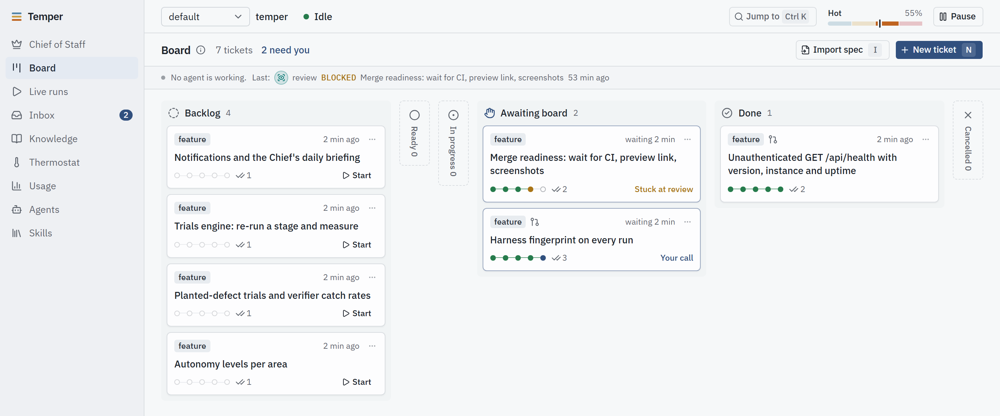
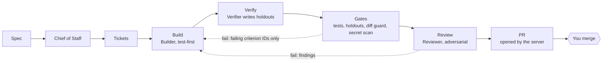
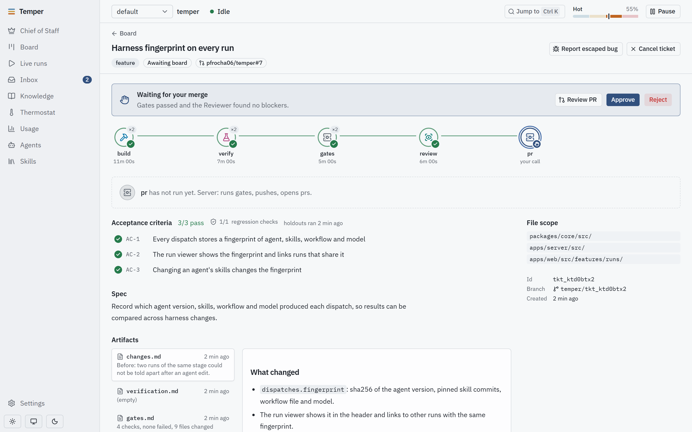
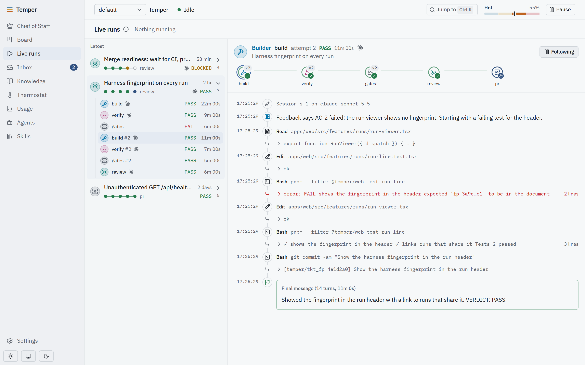

<div align="center">


# Temper

**A local, always-on software factory where trust in AI agents is measured, not assumed.**

Agents plan, build, verify and review changes to your repositories.
You set direction, approve merges, and hand over autonomy only as it is earned.

[](https://github.com/pfrocha06/temper/actions/workflows/ci.yml)
[](LICENSE)
[](https://nodejs.org)
[](#platform-support)
[](CONTRIBUTING.md)

[Quick start](#quick-start) · [How it works](#how-it-works) · [Docs](#documentation) · [Roadmap](https://github.com/pfrocha06/temper/issues/24) · [Contributing](CONTRIBUTING.md)

</div>

<picture>
  <source media="(prefers-color-scheme: dark)" srcset="docs/images/board-dark.png">
  
</picture>

<p align="center"><sub>The board, with sample tickets from Temper's own roadmap. Temper builds itself.</sub></p>

## Why Temper

Most agent harnesses take an agent's word that its work is done: the tests it wrote pass, so it
must be right. That breaks down exactly when you stop watching. Temper is built around the
opposite assumption, and enforces it in the server rather than in prompts.

- **The builder never owns the proof.** A separate Verifier writes behaviour tests
  ("holdouts") from the spec into a repository the Builder can't read. The Builder only ever
  learns *which* acceptance criteria failed.
- **The server, not the agents, touches the outside world.** Agents run in a sandbox with no
  network and commit locally. Only the server pushes, opens PRs and merges, and only after hard
  gates pass.
- **The Builder's own code runs sandboxed too.** When the server runs the Builder's tests or
  boots its app, those processes can't read holdouts or Temper's secrets either.
- **Health is a number.** A *temperature* computed from the audit log (reverts, escaped bugs,
  holdout failures, review disagreement) heats fast and cools only on evidence.

## Features

- **Ticket workflows as code.** Nine ticket types (feature, bugfix, refactor, investigation, perf, …),
  each a YAML graph of stages in [`workflows/`](workflows). Every stage ends in
  `VERDICT: PASS | FAIL | BLOCKED`; loops are capped and anything stuck lands in your inbox.
- **Four isolated roles plus a Chief of Staff.** Every run is a fresh session with only the
  skills, instructions and MCP servers its role is assigned. Your own agent settings never leak in.
- **Hard gates.** Builder tests, holdouts against the running app (API and browser checks), a diff
  guard that rejects weakened or skipped tests and out-of-scope edits, and a secret scan.
- **Two agent vendors.** Claude Code and Codex behind one adapter interface. Run the Verifier
  on a different vendor from the Builder, so another model family checks the work.
- **Isolation you can check.** `temper probe-isolation` plants canaries and proves agents, and the
  commands that run their code, can't read them.
- **A console for the board.** Board, live runs, inbox, thermostat, usage and caps, agents, skills,
  knowledge, and a conversation with the Chief of Staff, who can only *propose* your decisions.
- **Releases with rollback.** The service always runs a pinned, verified release; a failed
  deploy rolls back automatically.
- **An append-only audit log.** Every decision and transition is recorded and never rewritten.

## How it works



| Role | Does | Never |
|---|---|---|
| Chief of Staff | turns specs into tickets, curates shared knowledge, answers you | resolves your decisions itself |
| Builder | test-first changes in a git worktree, local commits | reads holdouts, weakens tests, pushes |
| Verifier | writes holdouts from the spec, runs them against the running app | edits product code |
| Reviewer | adversarial review of the diff against the spec | edits code |

<table>
<tr>
<td width="50%"></td>
<td width="50%"></td>
</tr>
<tr>
<td align="center"><sub>A ticket that looped once on a failing holdout, now waiting for your merge.</sub></td>
<td align="center"><sub>The Builder's second attempt, red to green, streamed live.</sub></td>
</tr>
</table>

## Quick start

You need [Node.js](https://nodejs.org) 22.18 or later, git, the [GitHub CLI](https://cli.github.com/)
and the [Claude Code CLI](https://docs.claude.com/en/docs/claude-code), both signed in, and
[gitleaks](https://github.com/gitleaks/gitleaks) 8.18 or later: Temper scans every change with it before pushing,
and pushes nothing without it.

**macOS and Linux**

```sh
curl -fsSL https://raw.githubusercontent.com/pfrocha06/temper/main/install.sh | sh
```

**Windows** (PowerShell)

```powershell
irm https://raw.githubusercontent.com/pfrocha06/temper/main/install.ps1 | iex
```

The installer:

1. checks your tools, and says what is missing and where to get it
2. clones Temper into `~/.temper/src`, installs its packages and builds the console
3. sets up the gate sandbox: `bubblewrap`, `socat` and `ripgrep` on Linux (through `sudo`),
   the `srt-sandbox` account on Windows (one admin prompt); nothing on macOS
4. puts a `temper` command on your PATH

Run it again to update. Read it first if you like: [install.sh](install.sh), [install.ps1](install.ps1).
`TEMPER_DIR`, `TEMPER_BIN_DIR`, `TEMPER_REF` and `TEMPER_NO_DEPS=1` change what it does.

### From source

```sh
git clone https://github.com/pfrocha06/temper.git
cd temper
pnpm install
pnpm check      # typecheck and tests
pnpm dev        # console on http://localhost:5173, server on :4610, with its own data
```

In a checkout, `node apps/server/src/cli.ts` is the `temper` command.

## Running Temper

```sh
# 1. A profile: which git host account the server acts as (kept in ~/.temper, never committed)
mkdir -p ~/.temper
cat > ~/.temper/profile.json <<'JSON'
{ "name": "default", "github": { "user": "<your-gh-user>" }, "adapters": ["claude-cli"], "plugins": ["github"] }
JSON

# 2. Build, verify and start a release (console on http://127.0.0.1:4600), then sign in as the board
temper deploy        # macOS (launchd) and Linux with systemd; on Windows run `temper serve` instead
temper open

# 3. Register a project. Temper creates its holdouts folder, ~/.temper/holdouts/myapp
temper project add --name myapp --repo ~/code/myapp \
  --remote https://github.com/<owner>/myapp.git \
  --setup "pnpm install --frozen-lockfile" \
  --test "pnpm test" \
  --app "pnpm start" --health /api/health

# 4. Before trusting the factory, prove nothing can read the holdouts or Temper's secrets
temper probe-isolation --holdouts ~/.temper/holdouts/myapp

# 5. Hand it work: the Chief of Staff splits the spec into tickets and starts them
temper import-spec --project <id> --file spec.md --start
```

`temper rollback` returns to the previous release and `temper pause` stops new work.

**Versions.** A release is a `vX.Y.Z` tag on `main` with a GitHub Release. To cut one, open
Actions › **release** › Run workflow and pick patch, minor or major. The workflow refuses unless CI
already passed on that commit on every platform. The console shows the running version next to
the name, for example `v0.2.0`, or `v0.2.0+3` for three commits past it.

**Updates.** The main instance fetches its checkout's `origin` every 30 minutes. When a newer
release exists, the console's top bar shows **Update to vX.Y.Z** with its commits and release
notes. Set `TEMPER_UPDATE_CHANNEL=main` to follow every merge to `main` instead. **Update now**
runs `temper deploy --when-idle` outside the service:

1. Builds the new commit and runs the full check, while Temper keeps working.
2. Pauses new dispatches and waits for running agents to finish.
3. Backs up the database and switches over.
4. Rolls back if the new release fails its health check.

The log is in `~/.temper/logs/update.log`. Set `TEMPER_UPDATE_CHECK=0` to turn checks off.

`temper help` lists every command.

### Work intake

Work reaches the factory as a spec, which the Chief of Staff splits into tickets:

```sh
temper import-spec   --project <id> --file spec.md --start          # a Markdown spec
temper import-github --project <id> --search "label:roadmap" --start  # GitHub issues
temper import-github --project <id> --issue 42                        # one issue
temper import-jira   --project <id> --jql "project = APP AND status = 'To Do'"
```

GitHub issues come from the project's own repository (or `--repo owner/name`), through the
`gh` account the profile pins. Each ticket links back to its issue, an issue already in progress is
skipped, and the PR says `Closes owner/name#42`, so merging closes the issue. On a public
repository anyone can open an issue, and its text becomes instructions for your agents: only issues
by people who can push to the repository are imported, unless you read one and pass `--any-author`.

In the console, **Board › Import issues** (or `E`) does the same with pickers: choose GitHub or
Jira, filter (GitHub: search, labels, milestone; Jira: project, epic, text, or raw JQL), fetch, tick
the issues you want and import. Fetching imports nothing, and each ticked issue is imported in its
own request, so a long batch shows progress per issue and can be stopped. The CLI's `--search` and
`--jql` work the same way.

Temper works on its own roadmap the same way: register this repository as a project, then
`temper import-github --project <id> --search "label:roadmap"`.

### Codex as a second vendor

With every role on one vendor, the Builder's work and its proof share blind spots. Put the
Verifier (or the Reviewer) on [Codex](https://developers.openai.com/codex/cli) to break that:

```sh
# 1. Enable it in ~/.temper/profile.json; optionally pin the account each CLI must be signed in as
#    "adapters": ["claude-cli", "codex-cli"], "accounts": { "codex-cli": "you@example.com" }

# 2. Sign Temper's own Codex in. It lives in ~/.temper/secrets/codex, apart from ~/.codex, so your
#    Codex config, AGENTS.md, hooks, plugins and memories never reach agent runs
temper codex login
temper codex setup        # Windows only: Codex's elevated sandbox, one admin prompt

# 3. Prove it is isolated before giving it work, then pick it on the Agents screen
temper probe-isolation --holdouts ~/.temper/holdouts/<project>
```

Codex runs in its own sandbox with a permission profile Temper writes per run: the workspace
writable, holdouts and Temper's secrets unreadable, loopback only, no internet, no web search.
On macOS, Codex's local-binding mode (which lets tests start their own servers) may also reach
private-network addresses; `probe-isolation` checks the internet, not your LAN.
Temper refuses to dispatch to an adapter the profile doesn't enable, or one signed in to an account
other than the one it pins, and records the refusal in the audit log.

### Holdouts

Each project has a holdouts folder: behaviour checks the Builder never sees, run by the server
against the Builder's running app. It sits outside the project, because a checkout's git history
would expose anything inside it ([ADR 0001](docs/adr/0001-holdouts-in-a-separate-repository.md)).
`temper project add` creates it in `~/.temper/holdouts/<project>` from a
[starter template](templates/holdouts); pass `--holdouts PATH` to use your own. It is a local git
repository (Temper commits every change and rejects ones that weaken a check); a remote is
optional, for backup.

- `baseline/`: checks every version of the app must pass.
- `tickets/<ticket-id>/`: checks for one ticket. Once it merges, they keep running as regression checks.
- `run.mjs` runs them against `TEMPER_APP_URL` and prints one `AC-<id>: PASS|FAIL` line per check.

Three ways to add checks:

1. **Write acceptance criteria** (`AC-1: …`) in the ticket or spec. The Verifier turns each one
   into a check.
2. **Open a verification ticket** for checks that belong to no single feature. The Verifier writes
   them, the Reviewer reviews them, and they wait for your approval.
3. **Write one yourself** in `baseline/` and commit it:

   ```js
   import { assert, suite } from "../lib/check.mjs";
   import { get } from "../lib/http.mjs";

   export default suite(async (check, { url }) => {
     await check("health", async () => {
       const { status } = await get(url, "/api/health");
       assert(status === 200, `status ${status}`);
     });
   });
   ```

## Platform support

| | macOS | Linux | Windows |
|---|:---:|:---:|:---:|
| Server, console and CLI | ✅ | ✅ | ✅ |
| Gate sandbox (Builder tests, candidate app) | ✅ built in | ✅ `bubblewrap`, `socat`, `ripgrep` ¹ | ✅ alpha, one-time setup ² |
| Background service (`temper start`) | ✅ launchd | run `temper serve` under your own service manager | run `temper serve` under your own service manager |
| Agent runs sandboxed (by the `claude` CLI) | ✅ | ✅ | check with `probe-isolation` |
| Agent runs sandboxed (by the `codex` CLI) | ✅ | ✅ | ✅ needs `temper codex setup`; no network, so keep the Verifier on Claude |

CI runs the full suite on all three, with the real sandbox installed.

¹ The installer installs them. Ubuntu 24.04 and later also need
`sudo sysctl -w kernel.apparmor_restrict_unprivileged_userns=0` for bubblewrap; the installer
tells you when.

² The installer runs `srt windows-install` (one UAC prompt); from a checkout, run
`pnpm --filter @temper/server exec srt windows-install`. It creates a dedicated `srt-sandbox` account and firewall rules for it; `windows-uninstall` removes them. That
account can't see inside your user profile, so on Windows worktrees and gate scratch files live
under `%ProgramData%\temper`, while holdouts and secrets stay in your profile, out of its reach.
Install tools machine-wide, or list per-user tool folders in `TEMPER_GATE_ALLOW_READ`.

## Configuration

| Variable | Default | What it does |
|---|---|---|
| `TEMPER_HOME` | `~/.temper` | All state: releases, instances, secrets |
| `TEMPER_WORKTREES` | `$TEMPER_HOME/worktrees` (Windows: `%ProgramData%\temper\worktrees\<instance>`) | Where ticket worktrees are created |
| `TEMPER_PORT` | `4600` (`4601` for a release candidate) | Port the server listens on (always `127.0.0.1`) |
| `TEMPER_INSTANCE` | `main` | Instance name; each has its own database |
| `TEMPER_HEARTBEAT_MS` | `15000` | How often the scheduler reconciles and dispatches |
| `TEMPER_CLAUDE_BIN` | `claude` | Path to the Claude Code CLI |
| `TEMPER_CODEX_BIN` | `codex` | Path to the Codex CLI |
| `TEMPER_CODEX_HOME` | `$TEMPER_HOME/secrets/codex` | Temper's own Codex login, kept apart from `~/.codex` |
| `TEMPER_GITLEAKS` | `gitleaks` | Path to gitleaks (8.18 or later); required to push changes |
| `TEMPER_GATE_SANDBOX` | `srt` | `off` runs gate commands unsandboxed; for development only |
| `TEMPER_GATE_ALLOW_READ` | | Extra folders gate commands may read (Windows), separated like `PATH` |
| `TEMPER_API_URL` | `http://127.0.0.1:4600` | Where the dev console proxies API calls |

## Repository layout

```
apps/server            API, scheduler, orchestrator, gates, sandbox, git service, CLI
apps/web               the console
packages/core          domain: tickets, dispatches, audit log, temperature, workflows, database
packages/adapters/*    agent CLI adapters: claude-cli, codex-cli
packages/mcp-temper    the MCP server agents use to reach Temper's knowledge and tools
plugins/*              git host and tracker plugins (github, jira)
workflows/             one workflow per ticket type
skills/                pinned registry of vendored and local agent skills
docs/                  design, ADRs, roadmap and specs
```

Built with TypeScript on Node.js: [Hono](https://hono.dev), [PGlite](https://pglite.dev) (Postgres
embedded in-process) with [Drizzle](https://orm.drizzle.team), React, Vite, Tailwind,
[shadcn/ui](https://ui.shadcn.com) and [Vitest](https://vitest.dev).

## Roadmap

Next up: a harness fingerprint on every run, merge readiness (wait for CI, previews, screenshots),
notifications and a daily briefing, then **planted-defect trials** that give each verifier a
measured catch rate, and **autonomy levels** that are earned per area from those rates and lost
when the temperature rises. Progress lives in the pinned [Roadmap issue](https://github.com/pfrocha06/temper/issues/24),
one issue per item, each linking a spec written to be picked up cold ([docs/roadmap.md](docs/roadmap.md)).

## Documentation

- [Design](docs/design.md): the model, roles, gates and definition of done
- [Glossary](CONTEXT.md): the words humans and agents share
- [Architecture decisions](docs/adr)
- [Specs](docs/specs) for upcoming work

## Contributing

Contributions are welcome, from bug reports to roadmap items. Read
[CONTRIBUTING.md](CONTRIBUTING.md) to get set up, and please follow the
[code of conduct](CODE_OF_CONDUCT.md). Report security problems privately, as described in
[SECURITY.md](SECURITY.md).

## Acknowledgements

Temper blends three bodies of practice: [Matt Pocock's skills](https://github.com/mattpocock/skills)
(alignment first, glossary and ADRs, spec to tracer-bullet tickets to TDD),
[pstack](https://github.com/backnotprop/pstack) (playbook routing, prove-it-works, adversarial
review, verification skills) and Paperclip (agents as an organisation: roles, tickets,
heartbeats, budgets, the human as the board). The self-improvement loop on the roadmap is inspired
by [Harness²](https://github.com/google-research/harness2). Gate commands are confined with
Anthropic's [sandbox runtime](https://www.npmjs.com/package/@anthropic-ai/sandbox-runtime).

The vendored skills in [`skills/vendor/`](skills/vendor) come from
[anthropics/skills](https://github.com/anthropics/skills),
[backnotprop/pstack](https://github.com/backnotprop/pstack),
[mattpocock/skills](https://github.com/mattpocock/skills),
[microsoft/playwright-cli](https://github.com/microsoft/playwright-cli),
[shadcn-ui/ui](https://github.com/shadcn-ui/ui) and
[vercel-labs/agent-skills](https://github.com/vercel-labs/agent-skills), each under its own licence.

## License

[MIT](LICENSE). Vendored skills keep their own licences; see
[THIRD_PARTY_NOTICES.md](THIRD_PARTY_NOTICES.md).
