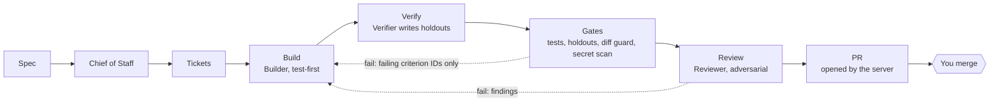

<div align="center">


# Temper

**A local, always-on software factory where trust in AI agents is measured, not assumed.**

Agents plan, build, verify and review changes to your repositories.
You set direction, approve merges, and hand over autonomy only as it is earned.

[](https://github.com/pfrocha06/temper/actions/workflows/ci.yml)
[](LICENSE)
[](https://nodejs.org)
[](#platform-support)
[](CONTRIBUTING.md)

[Quick start](#quick-start) · [How it works](#how-it-works) · [Docs](#documentation) · [Roadmap](docs/roadmap.md) · [Contributing](CONTRIBUTING.md)

</div>

<picture>
  <source media="(prefers-color-scheme: dark)" srcset="docs/images/board-dark.png">
  
</picture>

<p align="center"><sub>The board, with sample tickets from Temper's own roadmap. Temper builds itself.</sub></p>

## Why Temper

Most agent harnesses take an agent's word that its work is done: the tests it wrote pass, so it
must be right. That breaks down exactly when you stop watching. Temper is built around the
opposite assumption, and enforces it in the server rather than in prompts.

- **The builder never owns the proof.** A separate Verifier writes behaviour tests
  ("holdouts") from the spec into a repository the Builder can't read. The Builder only ever
  learns *which* acceptance criteria failed.
- **The server, not the agents, touches the outside world.** Agents run in a sandbox with no
  network and commit locally. Only the server pushes, opens PRs and merges, and only after hard
  gates pass.
- **The Builder's own code runs sandboxed too.** When the server runs the Builder's tests or
  boots its app, those processes can't read holdouts or Temper's secrets either.
- **Health is a number.** A *temperature* computed from the audit log (reverts, escaped bugs,
  holdout failures, review disagreement) heats fast and cools only on evidence.

## Features

- **Ticket workflows as code.** Nine ticket types (feature, bugfix, refactor, investigation, perf, …),
  each a YAML graph of stages in [`workflows/`](workflows). Every stage ends in
  `VERDICT: PASS | FAIL | BLOCKED`; loops are capped and anything stuck lands in your inbox.
- **Four isolated roles plus a Chief of Staff.** Every run is a fresh session with only the
  skills, instructions and MCP servers its role is assigned. Your own agent settings never leak in.
- **Hard gates.** Builder tests, holdouts against the running app (API and browser checks), a diff
  guard that rejects weakened or skipped tests and out-of-scope edits, and a secret scan.
- **Isolation you can check.** `temper probe-isolation` plants canaries and proves agents, and the
  commands that run their code, can't read them.
- **A console for the board.** Board, live runs, inbox, thermostat, usage and caps, agents, skills,
  knowledge, and a conversation with the Chief of Staff, who can only *propose* your decisions.
- **Releases with rollback.** The service always runs a pinned, verified release; a failed
  deploy rolls back automatically.
- **An append-only audit log.** Every decision and transition is recorded and never rewritten.

## How it works



| Role | Does | Never |
|---|---|---|
| Chief of Staff | turns specs into tickets, curates shared knowledge, answers you | resolves your decisions itself |
| Builder | test-first changes in a git worktree, local commits | reads holdouts, weakens tests, pushes |
| Verifier | writes holdouts from the spec, runs them against the running app | edits product code |
| Reviewer | adversarial review of the diff against the spec | edits code |

<table>
<tr>
<td width="50%"></td>
<td width="50%"></td>
</tr>
<tr>
<td align="center"><sub>A ticket that looped once on a failing holdout, now waiting for your merge.</sub></td>
<td align="center"><sub>The Builder's second attempt, red to green, streamed live.</sub></td>
</tr>
</table>

## Quick start

You need [Node.js](https://nodejs.org) ≥ 22, pnpm, git, the [GitHub CLI](https://cli.github.com/)
and the [Claude Code CLI](https://docs.claude.com/en/docs/claude-code), both signed in.

```sh
git clone https://github.com/pfrocha06/temper.git
cd temper
pnpm install
pnpm check      # tests, typecheck and the company-agnostic check
pnpm dev        # console on http://localhost:5173, server on :4610, with its own data
```

## Running Temper

```sh
# 1. A profile: which git host account the server acts as (kept in ~/.temper, never committed)
mkdir -p ~/.temper
cat > ~/.temper/profile.json <<'JSON'
{ "name": "default", "github": { "user": "<your-gh-user>" }, "adapters": ["claude-cli"], "plugins": ["github"] }
JSON

# 2. Build, verify and start a release (console on http://127.0.0.1:4600), then sign in as the board
node apps/server/src/cli.ts deploy --ref main
node apps/server/src/cli.ts open

# 3. Before trusting the factory, prove nothing can read your holdouts or secrets
node apps/server/src/cli.ts probe-isolation --holdouts <holdouts-checkout>

# 4. Register a project
node apps/server/src/cli.ts project add --name myapp --repo ~/code/myapp \
  --remote https://github.com/<owner>/myapp.git \
  --holdouts ~/code/myapp-holdouts \
  --setup "pnpm install --frozen-lockfile" \
  --test "pnpm test" \
  --app "pnpm start" --health /api/health \
  --holdouts-setup "pnpm install --frozen-lockfile" \
  --holdouts-cmd "node run.mjs"

# 5. Hand it work: the Chief of Staff splits the spec into tickets and starts them
node apps/server/src/cli.ts import-spec --project <id> --file spec.md --start
```

`temper rollback` returns to the previous release and `temper pause` stops new work.
`node apps/server/src/cli.ts help` lists every command.

### The holdouts repository

Holdouts live in their own git repository, outside the project, so the Builder never sees them
([ADR 0001](docs/adr/0001-holdouts-in-a-separate-repository.md)):

- `baseline/`: checks that must always pass.
- `tickets/<ticket-id>/`: checks the Verifier writes for one ticket. Once it merges, they keep
  running as regression checks.
- Each `*.holdout.mjs` default-exports `async ({ url, candidatePath }) => [{ id, pass, message }]`.
- `run.mjs` runs them against `TEMPER_APP_URL` and prints one `AC-<id>: PASS|FAIL` line per check.

## Platform support

| | macOS | Linux | Windows |
|---|:---:|:---:|:---:|
| Server, console and CLI | ✅ | ✅ | ✅ |
| Gate sandbox (Builder tests, candidate app) | ✅ built in | ✅ needs `bubblewrap`, `socat`, `ripgrep` | ✅ alpha, needs a one-time install ¹ |
| Background service (`temper start`) | ✅ launchd | run `temper serve` under your own service manager | run `temper serve` under your own service manager |
| Agent runs sandboxed (by the `claude` CLI) | ✅ | ✅ | check with `probe-isolation` |

CI runs the full suite on all three, with the real sandbox installed.

¹ Run `pnpm --filter @temper/server exec srt windows-install` once (one UAC prompt). It creates a
dedicated `srt-sandbox` account and firewall rules for it; `windows-uninstall` removes them. The
sandboxed account can't read per-user tool installs, so either install tools machine-wide or list
their folders in `TEMPER_GATE_ALLOW_READ`. Ubuntu 24.04 and later also need
`sudo sysctl -w kernel.apparmor_restrict_unprivileged_userns=0` for bubblewrap.

## Configuration

| Variable | Default | What it does |
|---|---|---|
| `TEMPER_HOME` | `~/.temper` | All state: releases, instances, worktrees, secrets |
| `TEMPER_PORT` | `4600` (`4601` for a release candidate) | Port the server listens on (always `127.0.0.1`) |
| `TEMPER_INSTANCE` | `main` | Instance name; each has its own database |
| `TEMPER_HEARTBEAT_MS` | `15000` | How often the scheduler reconciles and dispatches |
| `TEMPER_CLAUDE_BIN` | `claude` | Path to the Claude Code CLI |
| `TEMPER_GATE_SANDBOX` | `srt` | `off` runs gate commands unsandboxed; for development only |
| `TEMPER_GATE_ALLOW_READ` | | Extra folders gate commands may read (Windows), separated like `PATH` |
| `TEMPER_API_URL` | `http://127.0.0.1:4600` | Where the dev console proxies API calls |

## Repository layout

```
apps/server            API, scheduler, orchestrator, gates, sandbox, git service, CLI
apps/web               the console
packages/core          domain: tickets, dispatches, audit log, temperature, workflows, database
packages/adapters/*    agent CLI adapters (claude-cli first)
packages/mcp-temper    the MCP server agents use to reach Temper's knowledge and tools
plugins/*              git host and tracker plugins (github, jira)
workflows/             one workflow per ticket type
skills/                pinned registry of vendored and local agent skills
docs/                  design, ADRs, roadmap and specs
```

Built with TypeScript on Node.js: [Hono](https://hono.dev), [PGlite](https://pglite.dev) (Postgres
embedded in-process) with [Drizzle](https://orm.drizzle.team), React, Vite, Tailwind,
[shadcn/ui](https://ui.shadcn.com) and [Vitest](https://vitest.dev).

## Roadmap

Next up: a harness fingerprint on every run, merge readiness (wait for CI, previews, screenshots),
notifications and a daily briefing, then **planted-defect trials** that give each verifier a
measured catch rate, and **autonomy levels** that are earned per area from those rates and lost
when the temperature rises. See [docs/roadmap.md](docs/roadmap.md). Every item links a spec
written to be picked up cold.

## Documentation

- [Design](docs/design.md): the model, roles, gates and definition of done
- [Glossary](CONTEXT.md): the words humans and agents share
- [Architecture decisions](docs/adr)
- [Specs](docs/specs) for upcoming work

## Contributing

Contributions are welcome, from bug reports to roadmap items. Read
[CONTRIBUTING.md](CONTRIBUTING.md) to get set up, and please follow the
[code of conduct](CODE_OF_CONDUCT.md). Report security problems privately, as described in
[SECURITY.md](SECURITY.md).

## Acknowledgements

Temper blends three bodies of practice: [Matt Pocock's skills](https://github.com/mattpocock/skills)
(alignment first, glossary and ADRs, spec to tracer-bullet tickets to TDD),
[pstack](https://github.com/backnotprop/pstack) (playbook routing, prove-it-works, adversarial
review, verification skills) and Paperclip (agents as an organisation: roles, tickets,
heartbeats, budgets, the human as the board). The self-improvement loop on the roadmap is inspired
by [Harness²](https://github.com/google-research/harness2). Gate commands are confined with
Anthropic's [sandbox runtime](https://www.npmjs.com/package/@anthropic-ai/sandbox-runtime).

The vendored skills in [`skills/vendor/`](skills/vendor) come from
[anthropics/skills](https://github.com/anthropics/skills),
[backnotprop/pstack](https://github.com/backnotprop/pstack),
[mattpocock/skills](https://github.com/mattpocock/skills),
[microsoft/playwright-cli](https://github.com/microsoft/playwright-cli),
[shadcn-ui/ui](https://github.com/shadcn-ui/ui) and
[vercel-labs/agent-skills](https://github.com/vercel-labs/agent-skills), each under its own licence.

## License

[MIT](LICENSE). Vendored skills keep their own licences; see
[THIRD_PARTY_NOTICES.md](THIRD_PARTY_NOTICES.md).
